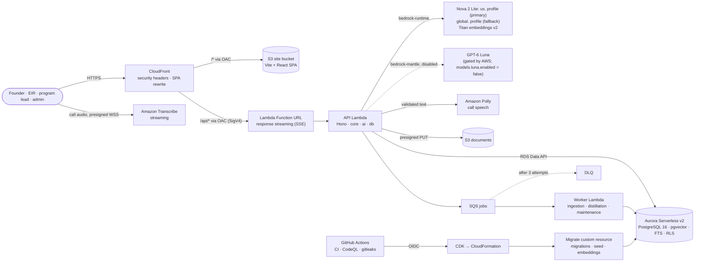

# Foundry Ascent

AI venture coaching for university founders. Each venture works with a **vEIR**: an AI coach built, with
consent, from an Entrepreneur-in-Residence's approved frameworks and coaching style. Founders talk to it
in chat or on a voice call, and it remembers their venture.

**Live:** <https://d38hejyf9iw77e.cloudfront.net/> (sign in with an access code from the platform owner).

[](https://github.com/satvikOS/Foundry-Ascent/actions/workflows/ci.yml)
[](https://github.com/satvikOS/Foundry-Ascent/actions/workflows/codeql.yml)
[](https://github.com/satvikOS/Foundry-Ascent/actions/workflows/security.yml)

> **All data in this system is synthetic.** Ventures, founders, EIRs and documents are invented
> ([ADR-0006](docs/architecture/adr/0006-synthetic-and-authorized-data-only.md)). A vEIR is an AI: it is
> not the EIR it was built from, and no human EIR wrote or approved its responses.

## What it does

- **A conversation-first console.** New chat and Call are one click away; past conversations sit in the
  sidebar, as in ChatGPT, Claude or Gemini. EIRs, program leads and admins work in the same shell.
- **Voice calls.** The founder's speech goes from the browser straight to Amazon Transcribe; the vEIR
  answers with validated text spoken by Amazon Polly, with live captions and a typed fallback
  ([ADR-0010](docs/architecture/adr/0010-realtime-webrtc-deferred.md)).
- **Knowledge pools.** Each vEIR has a common pool (the EIR's doctrine, style, knowledge library and
  published lessons) and a pool per venture (approved memory, documents, conversation digests and its
  notebook), which grows from conversations so the vEIR picks up where the founder left off
  ([ADR-0018](docs/architecture/adr/0018-veir-knowledge-pools.md)).
- **Evidence before eloquence.** Substantive answers cite the venture's memory and documents or the
  program's corpus, and label each claim as fact, inference, hypothesis or recommendation.
- **Memory you can see and correct.** The vEIR proposes typed memory with source links; people approve,
  correct, pin or delete it. Its notebook and digests are notes, never cited as facts.
- **Escalation is a feature.** IP, legal, investment, clinical, safety and conflict topics get
  educational framing and a handoff packet the founder approves before it reaches a human.
- **Venture-private by default.** Isolation is enforced in the service layer and by PostgreSQL row level
  security; no prompt is trusted to keep a secret.
- **Human authority.** Program leads and EIRs can suspend a persona, and admins can switch off all AI,
  calls or streaming, without engineering help.

## Architecture



Region `us-east-1`. No VPC for Lambdas and no NAT: the API reaches Aurora through the Data API, and Aurora
pauses to zero capacity after 10 idle minutes (idle bill ≈ $1–3/month). The first request after a pause
waits ~15 s while Aurora resumes; the app shows a "Waking up your workspace…" banner and retries. The
public health check never touches the database, so monitoring cannot keep it awake. Every IAM role carries
the `FoundryAscent-Boundary` permissions boundary. Details: [system design](docs/architecture/system-design.md)
and [`infra/cdk/README.md`](infra/cdk/README.md).

**Models.** Amazon Nova 2 Lite is the primary reasoning model (`us.amazon.nova-2-lite-v1:0`), with the
`global.amazon.nova-2-lite-v1:0` profile as fallback and Titan Text Embeddings V2 for retrieval. GPT-6 Luna
is wired in but gated by AWS for this account, so it is disabled behind `models.luna.enabled = false` in
[`infra/cdk/config/production.json`](infra/cdk/config/production.json); enabling it later is a reviewed
config change ([ADR-0014](docs/architecture/adr/0014-bedrock-models-luna-nova-titan.md#enabling-luna-later)).

## Repository map

| Path                                       | Contents                                                                                                                                     |
| ------------------------------------------ | -------------------------------------------------------------------------------------------------------------------------------------------- |
| [`apps/api`](apps/api)                     | Hono API, Lambda handlers (`api`, `worker`, `migrate`), local dev server                                                                     |
| [`apps/web`](apps/web)                     | Vite 8 + React 19 SPA (TanStack Router/Query, Tailwind CSS 4, Radix)                                                                         |
| [`packages/contracts`](packages/contracts) | Zod schemas shared by browser and server: domain, API DTOs, coach response, errors                                                           |
| [`packages/db`](packages/db)               | SQL migrations with RLS, Data API and node-postgres drivers, repositories, synthetic seed                                                    |
| [`packages/ai`](packages/ai)               | Model gateway (Nova, Titan, Luna, mock), prompts, risk classifier, validators, distillation                                                  |
| [`packages/core`](packages/core)           | Domain services: auth, authorization, orchestrator, memory, knowledge pools, calls, escalation, usage, audit                                 |
| [`infra/cdk`](infra/cdk)                   | AWS CDK app: Foundation, Data and App stacks, cdk-nag, tests                                                                                 |
| [`infra/iam`](infra/iam)                   | The permissions boundary and the (retired) stage-0 IAM policies                                                                              |
| [`evals`](evals)                           | Python scenario benchmark and red-team suite against a running API                                                                           |
| [`ops/aws`](ops/aws)                       | Python ops tooling: inventory, access verification, legacy cleanup, policy upsert                                                            |
| [`scripts/smoke.mjs`](scripts/smoke.mjs)   | Post-deploy smoke test                                                                                                                       |
| [`docs`](docs)                             | [Blueprints](docs/blueprints), [system design](docs/architecture/system-design.md), [ADRs](docs/architecture/adr), [runbooks](docs/runbooks) |

## Local development

Requires Node 24 (`.nvmrc`; ≥ 22.12 runs the app), pnpm 10.28 (`corepack enable`) and PostgreSQL 16 with
pgvector. Full instructions, Docker option and troubleshooting: [local development](docs/runbooks/local-development.md).

```bash
pnpm install
pnpm db:reset    # local database "foundry": migrations + synthetic seed; prints a DEV owner access code
pnpm dev         # API on http://localhost:8787 (mock model), web on http://localhost:5173
```

Open <http://localhost:5173/sign-in> and enter the printed code. The mock model is deterministic, so the
whole product runs offline at no cost. Without AWS a call uses typed input and the browser reads replies
aloud.

## Testing

| Suite                                                                                                    | Command                                                                          | CI job                       |
| -------------------------------------------------------------------------------------------------------- | -------------------------------------------------------------------------------- | ---------------------------- |
| Lint, format, types                                                                                      | `pnpm lint` · `pnpm format:check` · `pnpm typecheck`                             | `quality`                    |
| Unit (contracts, validators, risk classifier, authz, orchestrator with mock model, web components)       | `pnpm test`                                                                      | `quality`                    |
| Database integration: migrations, RLS for every table, authorization matrix, memory lifecycle, retrieval | `pnpm test:db`                                                                   | `database`                   |
| Lambda bundles, CDK assertions, cdk-nag, snapshots, full synth                                           | `pnpm --filter @foundry/api check:bundles` · `pnpm --filter @foundry/infra test` | `infra`                      |
| End-to-end founder journey with axe accessibility checks                                                 | `pnpm --filter @foundry/web e2e`                                                 | `e2e`                        |
| Python ops tooling and evals (offline, toolchain pinned in each `requirements-dev.txt`)                  | `ruff check` · `pytest` in `ops/aws` and `evals`                                 | `python`                     |
| Secret scanning (blocking); dependency audits and CodeQL (reported, non-blocking)                        | —                                                                                | `security.yml`, `codeql.yml` |

Generated files are checked in CI: the migrations bundle (`pnpm --filter @foundry/db gen:migrations`) and
the web route tree (`pnpm --filter @foundry/web build`).

## Deployment

Pushes to `main` that pass CI deploy to production through GitHub OIDC
([`deploy.yml`](.github/workflows/deploy.yml)): `cdk deploy --all` (Foundation → Data → App; database
migrations and the synthetic seed run inside the deployment, before new code goes live), then the smoke
test. How the account got there: [ADR-0016](docs/architecture/adr/0016-staged-iam-github-oidc.md).

**Owner access code.** There is no Cognito: people sign in with access codes
(`FA-XXXXX-XXXXX-XXXXX-XXXXX`). The owner's code is never in git: only its public prefix and scrypt hash
are in `infra/cdk/config/production.json`, and every deploy binds them to the owner principal
([access codes](docs/runbooks/access-codes.md)).

Rollback and failure handling: [deploy and rollback](docs/runbooks/deploy-and-rollback.md). What only the
owner can do (alarm subscriptions, budgets, GitHub settings, model access, reviews and consents):
[owner actions](docs/runbooks/owner-actions.md).

## Security and privacy

- **Data:** synthetic only until the University approves a data class. Venture content lives only in Aurora
  (encrypted at rest with AWS-managed keys) and the private documents bucket; models run on Amazon Bedrock
  in `us-east-1`. Call audio goes from the browser to Amazon Transcribe and is not stored by the platform.
- **Isolation:** service authorization on every request plus row level security under a dedicated
  `NOBYPASSRLS` role; retrieval always filters by venture before ranking; credential, ledger and audit
  tables are closed to request code.
- **Identity:** per-person access codes stored as scrypt hashes; 12-hour `HttpOnly` `SameSite=Strict`
  session cookies; lockout after repeated failures; CSRF header on every write.
- **Edge:** private origins behind CloudFront OAC, strict CSP, HSTS, `X-Frame-Options: DENY`; the
  microphone is allowed for this origin only and the camera never.
- **Logging:** structured JSON with request ids; never prompts, model output, documents or memory content.
- **AI safety:** deterministic risk pre-classifier, output validators, forced escalation for high-risk
  topics, persistent AI disclosure, kill switches.
- **Cost:** the permissions boundary denies cost hazards (NAT, EC2, customer KMS keys, provisioned
  capacity); daily AI spend caps (platform-wide and per person), call-minute caps and turn rate limits are
  checked before every model call and every spoken reply; alarms go to an SNS topic
  ([cost controls](docs/runbooks/cost-controls.md)).
- **Supply chain:** pinned actions (commit SHAs), frozen lockfile, Dependabot, gitleaks, CodeQL,
  dependency audits; no long-lived cloud credentials (GitHub OIDC).

Report vulnerabilities privately as described in [SECURITY.md](SECURITY.md).

## Documentation

- Blueprints: [`docs/blueprints/`](docs/blueprints) (01 capstone scope · 02 product and operating
  blueprint · 03 technical architecture · 04 executive proposal · 05 partnership and platform blueprint)
- [System design](docs/architecture/system-design.md) — the V1 build specification
- [Architecture decision records](docs/architecture/adr/README.md)
- [Runbooks](docs/runbooks/README.md), including [owner actions](docs/runbooks/owner-actions.md)
- [Contributing](CONTRIBUTING.md) · [Security policy](SECURITY.md)
