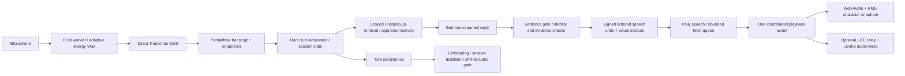

# Voice pipeline, measurement and cancellation

This diagram describes the actual retained AWS stack; no OpenAI Realtime, new speech service or avatar-inference server was introduced. Text/call/avatar share the session. Real source citations remain visual; spoken replies use a short speech register without raw Markdown/citation IDs. Context assembly remains bounded; active AI proposals are excluded from venture-memory retrieval until approval. The static policy prefix remains cacheable.

## Cancellation

The engine's epoch/generation, turn AbortController and SpeechPlayer cancellation invalidate obsolete SSE units, pending fetch/decode, queued speech and playback completions. A detected interruption calls local stop before the asynchronous server notification; the notification includes the last unit actually heard. End/disconnect/mode changes fence stale callbacks. The local avatar is passive: state/silence closes its mouth and it cannot keep audio alive. Remote presentation uses the same video/audio media element and local speech is suppressed for remote-owned units. Remote failure gives future units back to the local player; it does not start a second copy of a unit that played remotely.

Hands-free interruption is deliberately classified: VAD ducks output, sustained speech or stable non-echo/non-backchannel words take the floor. A brief “mm-hmm” must not discard a useful response. Explicit Interrupt/Escape and push-to-talk provide immediate control. Sound onset to interruption classification differs from detected interruption to local stop; these must never be combined into one favorable metric. The live baseline's ~1.2s onset-to-stop remains an issue requiring provider-level retesting.

## Diagnostics

`VoiceTimings` retains at most 128 numeric samples per stage, no content or identity. `CallEngine.diagnostics()` exposes n/p50/p95/p99 for setup, VAD-to-final-transcript, endpointing, submit-to-playback, VAD-end-to-playback and detected-interrupt-to-stop-scheduled. Captions-only replies are excluded from audio metrics; existing per-call first-audio stats are bounded too. These callbacks estimate browser scheduling. They do not prove an acoustic sound reached a student's ear. VAD end is an energy estimate, not a known fixture boundary. The existing AWS lab uses recorded fixtures with known utterance boundaries and reports endpointing, model, retrieval, first speech and Polly timings separately.

To inspect all stages, combine browser diagnostics with the existing content-free server `latency.*` events (session admission, query counts, embedding/retrieval, model start/first token, sentence gate, first signed speech, Polly first byte and persistence). Avatar synchronization needs real-provider instrumentation/recording in the remote lab. No additional logging of student text is introduced.

## Results and limits

The committed `evidence/aws-baseline/summary.json` is a live Bedrock/Transcribe/Polly run on `main` revision 04df967, not this upgraded branch. It includes all eight successful measured turns and both interruptions. That small run cannot support strong tail-latency guarantees. `evidence/media/results.json` is a real Chromium decode/source/gain/analyser graph with synthetic WAV signals and a fake output device; its latency begins at playback submission, not the end of a student's utterance. Its avatar and analyser are sampled in one callback, so the reported zero graph callback offset is not a measured acoustic lip-sync offset. Do not compare those milliseconds against the full voice-turn target.

The additional main-branch LITE baseline (evidence/heygen-baseline) exposed 0/7 expected relay acknowledgments and three local playbacks after the face joined; its high-level pass does not establish correct audio ownership. No physical-device or acoustic-loopback measurements were made. Headless Chromium's fake capture tests verify track release, not microphone sensitivity, accents, Bluetooth or speaker echo cancellation. Cold AWS startup, live concurrency, prolonged thermal behavior, physical Safari/Firefox, and the upgraded policy's inference latency require further validation. The delivery report records exact denominators and target gaps.
